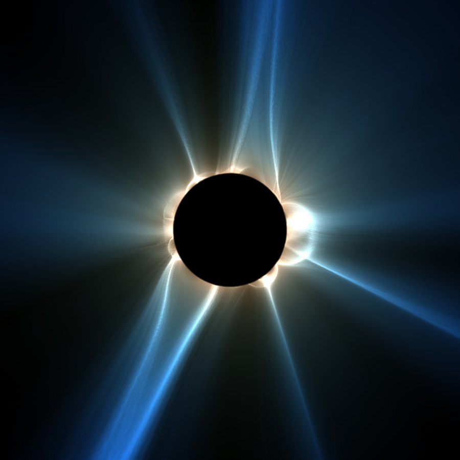
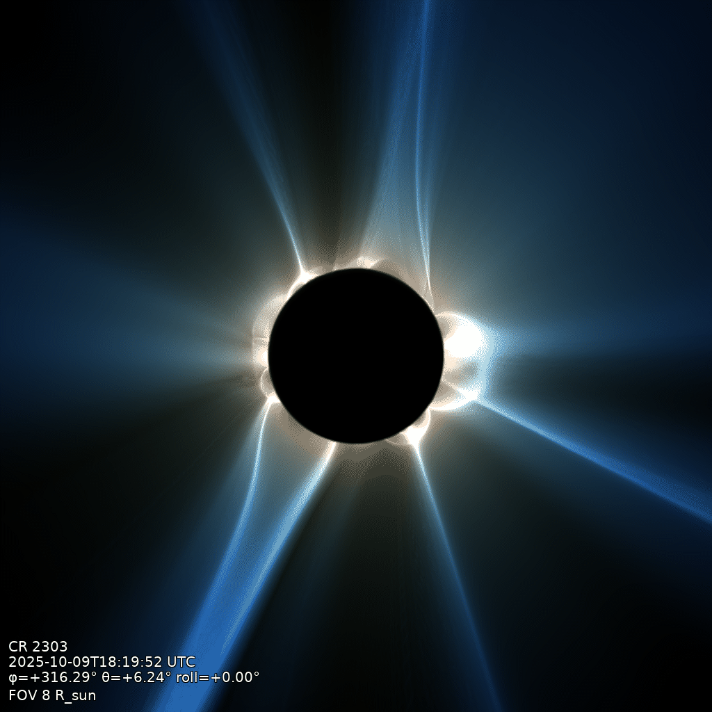

# Qorona {.qhide}

<div class="qhero">
  
  <div class="qhero-fade"></div>
  <div class="qhero-inner">
    <p class="qhero-wm">Qorona<span class="qhero-perp">&#x22A5;</span></p>
    <p class="qhero-tag">Synthetic coronal imagery from global MHD solutions</p>
    <div class="qhero-rule"></div>
  </div>
</div>

Qorona turns a global coronal **MHD solution** into **eclipse-like synthetic imagery**. Its
primary product is a line-of-sight integral of the perpendicular magnetic **squashing factor
Q⊥**, the quantity that lights up the thin loops, streamers, and current sheets seen at a
total solar eclipse. The result is rendered for morphological comparison against eclipse and
coronagraph observations.

```
coronal MHD solution ──▶ read ──▶ resample ──▶ Q⊥ volume ──▶ LOS render ──▶ synthetic eclipse image
```



??? note "How this image was made"
    The example solution of the [quick start](getting-started/first-eclipse-image.md), built once and rendered once:

    ```bash
    qorona build data/coconut_corona.CFmesh.xz -o data/coconut_corona.qor \
        --timestamp 2025-10-09T18:19:52 --frame carrington --outer-radius 8
    qorona render data/coconut_corona.qor -o data/eclipse.png \
        --fov 8 --observer earth
    ```

| | |
|---|---|
| **Get started** | [Installation](getting-started/installation.md), [Quick start](getting-started/first-eclipse-image.md) |
| **Products** | [Squashing-factor render](products/squashing-factor.md), [polarity view](products/polarity.md), [white-light imaging](products/white-light.md), [EUV imaging](products/euv.md), [Q-maps](products/qmaps.md), [field lines](products/fieldlines.md). Each page gives the command that made its figure. |
| **Guides** | [Camera and viewpoint](camera.md), [solution time and frame](time-and-frame.md), [the Q⊥ volume](qperp-volume.md), [export to JHelioviewer](jhelioviewer.md), [GPU acceleration](gpu.md), [HPC clusters](getting-started/hpc.md) |
| **Heliosphere and PUNCH** | [Heliospheric solutions](heliospheric.md), [comparing with PUNCH](punch.md) |
| **Reference** | [Supported models](getting-started/supported-models.md) |
