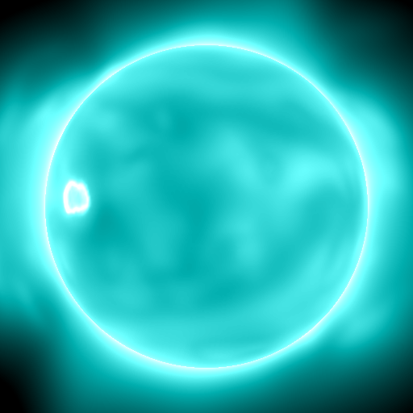
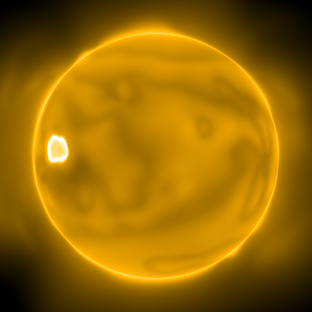
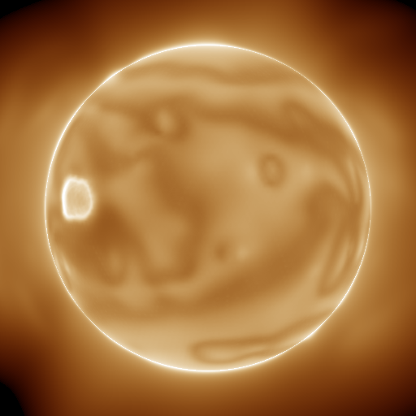
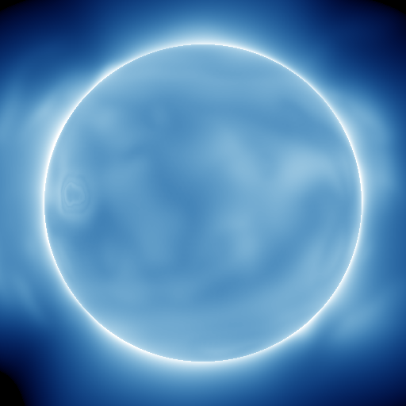

# EUV imaging

Synthetic extreme-ultraviolet (EUV) images of the solution, in the channels and units of SDO/AIA,
STEREO/EUVI and Solar Orbiter/EUI. This product uses the electron density and the temperature. It
does not build a Q⊥ volume.

| AIA 94 | AIA 131 | AIA 171 | AIA 193 |
|:------:|:-------:|:-------:|:-------:|
|  |  |  |  |

| AIA 211 | AIA 335 | EUVI-A 195 (STEREO-A) | EUI FSI 174 (Solar Orbiter) |
|:-------:|:-------:|:---------------------:|:---------------------------:|
|  |  |  |  |

The gallery shows the example solution of the
[quick start](../getting-started/first-eclipse-image.md) in eight channels. Each image has its own
display range, so the gallery compares shapes, not brightness.

??? note "The commands of the gallery"
    The gallery images are 512 × 512 pixels, without the colour bar and the stamp. Each image is
    the view from the spacecraft of its channel at the solution time.

    ```bash
    qorona euv data/coconut_corona.CFmesh.xz -o data/euv.png \
        --timestamp 2025-10-09T18:19:52 --frame carrington --range auto \
        --width 512 --height 512 --no-colorbar --no-annotate \
        --channel aia-94,aia-131,aia-171,aia-193,aia-211,aia-335
    qorona euv data/coconut_corona.CFmesh.xz -o data/euv_euvi-a-195.png \
        --timestamp 2025-10-09T18:19:52 --frame carrington --range auto \
        --width 512 --height 512 --no-colorbar --no-annotate --channel euvi-a-195
    qorona euv data/coconut_corona.CFmesh.xz -o data/euv_eui-fsi-174.png \
        --timestamp 2025-10-09T18:19:52 --frame carrington --range auto \
        --width 512 --height 512 --no-colorbar --no-annotate --channel eui-fsi-174
    ```

The commands below make the same AIA images at the default size, 1024 × 1024 pixels, with the
colour bar and the stamp.

To make one image, give one channel. This command writes `data/euv.png`:

```bash
qorona euv data/coconut_corona.CFmesh.xz -o data/euv.png \
    --timestamp 2025-10-09T18:19:52 --frame carrington --range auto \
    --channel aia-193
```

To make one image for each channel, give a comma list of channels of one instrument. This command
writes one file for each channel, for example `data/euv_aia-193.png`:

```bash
qorona euv data/coconut_corona.CFmesh.xz -o data/euv.png \
    --timestamp 2025-10-09T18:19:52 --frame carrington --range auto \
    --channel aia-94,aia-131,aia-171,aia-193,aia-211,aia-335
```

These commands use `--range auto`, which fits the display range to each image. The values of the
example solution are far below the observed AIA values. With the default display range, its image
is black, and `euv` tells you to try `--range auto`.

The input is a coronal solution file with a density, and a temperature or a pressure. A `.qor`
volume does not keep the temperature, so `euv` does not accept it.

## Flags

| Flag | Use | Default |
|------|-----|---------|
| `--channel` | The channel: `aia-94`, `aia-131`, `aia-171`, `aia-193`, `aia-211`, `aia-335`, `euvi-a-171`, `euvi-a-195`, `euvi-a-284` (the same for `euvi-b`) or `eui-fsi-174`. A comma list of channels of one instrument writes one image for each channel. | `aia-193` |
| `--timestamp` | The time of the solution, in UTC. With it, the camera is at the spacecraft of the channel at that time. See [Solution time and frame](../time-and-frame.md). | none |
| `--frame` | The frame of the input solution: `carrington` or `stonyhurst`. See [Carrington or Stonyhurst](../time-and-frame.md#carrington-or-stonyhurst). | `carrington`, with a warning |
| `--observer` | The spacecraft that views the solution: `earth`, `stereo-a`, `stereo-b`, `solo` or `psp`. See [Use a real observer](../camera.md#use-a-real-observer). | set automatically |
| `--tr-temperature` | The broadening temperature Tc of the run, in K, or `none`. See [Transition region](#transition-region). | from the run log, if there is one |
| `--abundances` | The element abundances of the response tables: `coronal-2021` or `schmelz-2012`. | `coronal-2021` |
| `--range LO,HI` | The display range of the log image, in the channel unit. `auto` uses the 0.5 and 99.9 percentiles of the image. | a fixed range for each channel |
| `--no-colorbar` | Removes the colour bar beside the image. | colour bar |
| `--no-absorption` | Removes the foreground absorption. | absorption |
| `--step` | The line-of-sight sample spacing, in solar radii. | 0.001 |
| `--export npz` | Also writes the physical frame and the image axes, in degrees. See [Exported values](#exported-values). | none |
| `--export fits` | Also writes the physical frame as FITS, with the WCS of the camera. Needs `--timestamp`. See [Export to JHelioviewer](../jhelioviewer.md#fits-images). | none |

- Camera flags: see [Camera and viewpoint](../camera.md). `euv` uses the perspective camera only.
  The default field of view is the field of the instrument, at 1024 × 1024 pixels.
  `--instrument aia`, `euvi-a`, `euvi-b` or `eui-fsi` gives the native frame of the instrument.
- `euv` sets `--observer` automatically to the spacecraft of the channel: `earth` for AIA,
  `stereo-a` or `stereo-b` for EUVI, `solo` for EUI/FSI. This needs `--timestamp`.
- `qorona euv --help-all` lists all the flags, including the flags of the internal grid
  (`--outer-radius`, `--n-r` and others). See [Method](#method).

## Method

- Each pixel integrates `nₑ² K(T, nₑ)` along the line of sight, through the corona. `K` is the
  response of the channel to the lines and the continuum of the plasma. See
  [Response tables](#response-tables).
- The density and the temperature are resampled onto an internal spherical grid from 1 to 3 solar
  radii, with 384 × 180 × 360 nodes (radius, colatitude, longitude) and a logarithmic radial
  spacing. If the field of the camera reaches further, the grid extends to it, with the same
  radial spacing at the base.
- The emission is optically thin. The solar body is opaque: a line of sight that meets the body
  stops at the inner radius of the grid.
- The foreground absorption by the photoionization of H I, He I and He II dims the emission behind
  cool, dense plasma. The cross-section is that of the nominal wavelength of the channel. The
  cross-sections follow the `ismeuv` routine of the IDL Astronomy User's Library.
- The electron density is `ρ / (μ m_p)`, with the `μ` of the model. See
  [Brightness units](white-light.md#brightness-units).
- The plasma has one temperature. If the solution stores the temperature, `euv` uses it. If not,
  the temperature is `p / (2 nₑ k)`.
- Each point of the grid emits at its one temperature, with no spread of temperatures below the
  resolution of the model. The ratios between two channels then vary less in the synthetic image
  than in the observed one (Downs et al. 2010).

## Units

The values are for one native pixel of the instrument, at any image size. `--width` changes the
sharpness, not the values.

| Instrument | Unit | Native pixel |
|------------|------|--------------|
| AIA | DN s⁻¹ per pixel | 0.6″ |
| EUI/FSI | DN s⁻¹ per pixel | 4.44″ |
| EUVI | detected photons s⁻¹ per pixel, as in EUVI Level 1 images | 1.588″ (EUVI-A), 1.590″ (EUVI-B) |

## Exported values

The PNG is a display image: the logarithm of the frame on the display range, in the colour map of
the channel. To get the values, add `--export npz` or `--export fits`. With a list of channels,
each channel has its own files, named like its PNG.

| Export | Content |
|--------|---------|
| `npz` | `frame`: the image in the channel unit, float32. `x_deg`, `y_deg`: the image axes, in degrees from Sun centre, with row 0 at the top of the image. `impact`: the distance of each line of sight from Sun centre, in solar radii. `unit`: the unit of `frame`. `meta`: the run settings, as JSON. |
| `fits` | One float32 image in the channel unit. See [FITS images](../jhelioviewer.md#fits-images) for the coordinates. `BUNIT` is the unit, `DETECTOR` the channel, `WAVELNTH` its wavelength, `NATPIXEL` the native pixel in arcseconds, `TRTEMP` the Tc of the [transition-region](#transition-region) correction, and `DISPMIN` and `DISPMAX` the display range of the PNG. The `HIERARCH QORONA` cards hold the run settings. |

The run settings include the internal grid, `μ`, the source of the temperature, the abundances, the
CHIANTI version and the response file of each channel.

## Compare with observations

1. Render the synthetic image with `--timestamp` and `--frame` set to the time and the frame of the
   solution. The camera is then at the position of the spacecraft of the channel at that time.
2. Add `--export fits`. The command then also saves the image as a FITS file, with the coordinates
   and the observer that the comparison needs.
3. Compare the FITS file with the observed image nearest to the solution time, with the
   [comparison script](#the-comparison-script). The script prepares the observed image as the
   table below shows, puts it on the pixels of the synthetic image, and compares the two.

For the example solution and AIA 193, the commands are:

```bash
qorona euv data/coconut_corona.CFmesh.xz -o data/euv.png \
    --timestamp 2025-10-09T18:19:52 --frame carrington --range auto --channel aia-193 \
    --export fits
python compare_euv.py data/euv.fits aia.lev1.193A_2025_10_09T18_19_40.84Z.image_lev1.fits
```

The first command writes `data/euv.fits`. The second writes the figure `data/euv_vs_observed.png`.

| Instrument | Observed image | Preparation |
|------------|----------------|-------------|
| AIA | Level 1 from the [JSOC](http://jsoc.stanford.edu/), in DN | Correct the image for the degradation of the instrument, for example with `aiapy`: the response tables are those of the instrument without degradation. Then divide the image by the exposure time (`EXPTIME`). |
| EUVI | Level 1 from `secchi_prep` (SolarSoft), in photons s⁻¹ | None: `secchi_prep` applies the calibration and the degradation correction. The [STEREO Science Center](https://stereo-ssc.nascom.nasa.gov/) has the files that `secchi_prep` reads. |
| EUI/FSI | Level 2 from the [Solar Orbiter Archive](https://soar.esac.esa.int/soar/), in DN s⁻¹ | None: Level 2 is the calibrated EUI product for quantitative work. |

The degradation correction is large: for AIA 193 on 2025-10-09, it doubles the observed values.

If you compare without the script:

- Resample the observed image with the coordinates (WCS) of the two files, not by pixel position.
  The observed images are not exactly centred on the Sun, and EUVI and EUI/FSI images can have a
  roll of several degrees. This is also true for a synthetic image made with `--instrument`: the
  flag gives the pixel scale and the size of the instrument frame, centred on the Sun and without
  roll.
- Average the observed pixels onto the pixels of the synthetic image. Do not sum them. At any
  image size, the value of a synthetic pixel is that of one native pixel, along one line of sight
  through the pixel centre.

## Effects not in the synthetic image

Published comparisons of global models with EUV observations judge the shapes and the relative
contrast first, because the absolute levels often differ by large factors. For example, Jin et
al. (2022) scale the synthetic 171 Å and 211 Å irradiances of their model by 4.4 and 16.5 to match
the observed ones.

The synthetic image is the optically thin collisional emission of the model, as an ideal
instrument records it. It does not include these effects:

| Effect | Size | What to do |
|--------|------|------------|
| Scattered light (point-spread function) | AIA spreads 37 % to 55 % of the light over the detector. A correction makes bright regions about 30 % brighter and dark regions up to 90 % fainter (Hofmeister et al. 2025). | In the observed image, dark regions such as coronal holes and the corona off the limb are too bright. For these regions, use an observed image corrected for the point-spread function, or read the comparison with care. |
| Resonant scattering of disk light | In the 174 Å band, outside streamers, it is as bright as the collisional emission at about 2 solar radii (Goryaev et al. 2014). | Outside streamers, read the synthetic image as a lower limit above about 2 solar radii. This applies mostly to the wide field of EUI/FSI. |
| Abundances | From 1 to 2.5 MK, the emission in these channels is approximately proportional to the iron abundance. `coronal-2021` multiplies the photospheric abundance of iron and the other low-FIP elements by 10^0.5 ≈ 3.2 (Dere et al. 2023). Coronal holes have a much smaller enhancement (Laming 2015). | In coronal holes, the synthetic image can be up to about 3 times too bright. Use the `--abundances` set closest to the abundances that the model uses for its radiative loss. Render also with the other set to see how much the abundances change the result. |
| Uncertainty of the synthesis | About 35 %: 25 % from the atomic data and 25 % from the calibration of the instrument (Parenti et al. 2022; for AIA, Boerner et al. 2014). Time-dependent ionization adds up to 20 % on the disk, and more off the limb in polar coronal holes and streamer legs (Szente et al. 2023). | Do not read a difference of this size as a fault of the model. |

## The comparison script

Download [`compare_euv.py`](../scripts/compare_euv.py). It needs the packages that Qorona
installs, with sunpy 6.0 or later. If `aiapy` is installed (`pip install aiapy`), the script
corrects an AIA image for degradation by itself. For this, `aiapy` downloads a calibration table,
which needs an internet connection. Without `aiapy`, the script does not correct the image, and it
says so in the terminal and on the figure.

??? example "compare_euv.py"
    ```python
    --8<-- "scripts/compare_euv.py"
    ```

- The script writes the figure `MODEL_vs_observed.png` beside `MODEL.fits`, and prints its path.
- The figure shows the observed image and the synthetic image ("Model"), each with its own display
  range and colour bar, so the two images compare shapes, not brightness. To compare the
  brightness, the figure has a profile: the median of each ring of 0.02 solar radius, for each
  image.
- The script prints the median ratio model / observed on the disk and in three bands off the
  limb: 1.0 to 1.1, 1.1 to 1.3 and 1.3 to 2.0 solar radii. It does not print a band with fewer
  than 100 pixels to compare.
- The comparison stops at the first ring off the limb where more than 10 % of the observed pixels
  are zero or negative. Beyond this ring, the observed image is outside the field of the
  instrument or holds only noise. For AIA, this is about 1.5 solar radii, in the corners of the
  image. The script prints this distance. The figure and the bands end at it.

## Response tables

Each channel has one response table for each set of abundances. The tables come with Qorona. Each
table gives `K` at fixed temperatures and electron densities.

| Item | Value |
|------|-------|
| Atomic data | CHIANTI 11.0.2, with the CHIANTI ionization equilibrium file `chianti.ioneq` |
| Calculation | [fiasco](https://fiasco.readthedocs.io/) 0.9.0 |
| Emission | The spectral lines, and the free-free, free-bound and two-photon continua |
| `coronal-2021` | The CHIANTI abundance file `sun_coronal_2021_chianti` |
| `schmelz-2012` | The CHIANTI abundance file `sun_coronal_2012_schmelz` |
| AIA response | `aia_V8_all_fullinst.genx`, read with `aiapy`, without degradation, with the crosstalk between channels |
| EUVI response | `ahead_sra_001.geny` (EUVI-A) and `behind_sra_001.geny` (EUVI-B), with the open position of the filter wheel |
| EUI/FSI response | `FSI_Response_Merged_R0_AlZr25_V2.txt` |
| Temperatures | 10⁴ to 10⁸ K, at steps of 0.02 in log₁₀ T (201 values) |
| Electron densities | 10⁶ to 10¹³ cm⁻³, at steps of 0.1 in log₁₀ nₑ (71 values) |

- Between these values, `euv` interpolates `log K` linearly in `log T` and `log nₑ`.
- Below 10⁴ K, the plasma gives no emission in these channels.
- Above 10⁸ K, and outside the density limits, `K` keeps the value at the limit.
- The tables use ionization equilibrium. They do not include time-dependent ionization.

## Transition region

Some runs include the transition region: their inner boundary is in the chromosphere, below
10⁵ K. The solver broadens this thin layer artificially below a temperature Tc, which is a setting
of the run. The broadened layer is far too bright in EUV. `euv` divides the emission by
`f(T) = [1 + (T / Tc)⁻¹⁰]^(1/4)` (Iijima & Imada 2021). Above approximately 2 Tc, `f` is 1.

`euv` finds the transition region with a test on the base layer of the solution: the cells within
1.005 times the smallest cell radius. If the median temperature of this layer is below 10⁵ K, the
solution includes the transition region.

| Solution | Tc |
|----------|----|
| MAS, with the `omas` run log next to its files | Read from the log (`T_CUTOFF1`). |
| Other runs with a transition region | Give it with `--tr-temperature`, for example `--tr-temperature 2e5`. |
| Runs without a transition region | Not needed. |

- If the solution includes the transition region and Tc is not known, `euv` stops. Give
  `--tr-temperature`, or `--tr-temperature none` to render without the correction.
- `--tr-temperature` overrides the value of the run log.
- The run summary and the FITS header (`TRTEMP`) show Tc.

## References

- Dere, K. P., et al. 1997, *Astronomy and Astrophysics Supplement Series*, 125, 149. The CHIANTI
  atomic database. [doi:10.1051/aas:1997368](https://doi.org/10.1051/aas:1997368)
- Dere, K. P., et al. 2023, *The Astrophysical Journal Supplement Series*, 268, 52. CHIANTI 10.1:
  the ionization equilibrium file `chianti.ioneq` and the abundance file
  `sun_coronal_2021_chianti`.
  [doi:10.3847/1538-4365/acec79](https://doi.org/10.3847/1538-4365/acec79)
- Dufresne, R. P., et al. 2024, *The Astrophysical Journal*, 974, 71. CHIANTI 11, the version of
  the response tables. [doi:10.3847/1538-4357/ad6765](https://doi.org/10.3847/1538-4357/ad6765)
- Schmelz, J. T., et al. 2012, *The Astrophysical Journal*, 755, 33. The coronal abundances of
  `schmelz-2012`. [doi:10.1088/0004-637X/755/1/33](https://doi.org/10.1088/0004-637X/755/1/33)
- Laming, J. M. 2015, *Living Reviews in Solar Physics*, 12, 2. The FIP effect: the abundances of
  the corona. [doi:10.1007/lrsp-2015-2](https://doi.org/10.1007/lrsp-2015-2)
- Iijima, H., & Imada, S. 2021, *The Astrophysical Journal*, 917, 65. The correction of the
  broadened transition region.
  [doi:10.3847/1538-4357/ac07a5](https://doi.org/10.3847/1538-4357/ac07a5)
- Szente, J., et al. 2023, *The Astrophysical Journal Supplement Series*, 269, 37. The effect of
  time-dependent ionization on synthetic EUV images.
  [doi:10.3847/1538-4365/ad0232](https://doi.org/10.3847/1538-4365/ad0232)
- Goryaev, F., et al. 2014, *The Astrophysical Journal*, 781, 100. Collisional emission and
  resonant scattering in a streamer and in the background corona.
  [doi:10.1088/0004-637X/781/2/100](https://doi.org/10.1088/0004-637X/781/2/100)
- Downs, C., et al. 2010, *The Astrophysical Journal*, 712, 1219. A single temperature at each
  point of a global model, against the observed ratios between EUV channels.
  [doi:10.1088/0004-637X/712/2/1219](https://doi.org/10.1088/0004-637X/712/2/1219)
- Parenti, S., et al. 2022, *The Astrophysical Journal*, 929, 75. The uncertainty of the EUV
  synthesis in a comparison of a global model with observations.
  [doi:10.3847/1538-4357/ac56da](https://doi.org/10.3847/1538-4357/ac56da)
- Jin, M., et al. 2022, *The Astrophysical Journal*, 928, 154. The synthetic EUV irradiances of a
  global model, scaled to the observed ones.
  [doi:10.3847/1538-4357/ac589b](https://doi.org/10.3847/1538-4357/ac589b)
- Lemen, J. R., et al. 2012, *Solar Physics*, 275, 17. The AIA instrument.
  [doi:10.1007/s11207-011-9776-8](https://doi.org/10.1007/s11207-011-9776-8)
- Boerner, P., et al. 2012, *Solar Physics*, 275, 41. The calibration and the temperature
  response of AIA. [doi:10.1007/s11207-011-9804-8](https://doi.org/10.1007/s11207-011-9804-8)
- Boerner, P. F., et al. 2014, *Solar Physics*, 289, 2377. The cross-calibration of AIA with
  other instruments. [doi:10.1007/s11207-013-0452-z](https://doi.org/10.1007/s11207-013-0452-z)
- Hofmeister, S. J., et al. 2025, *The Astrophysical Journal Supplement Series*, 278, 8. The
  point-spread functions of AIA.
  [doi:10.3847/1538-4365/adbaed](https://doi.org/10.3847/1538-4365/adbaed)
- Barnes, W. T., et al. 2020, *Journal of Open Source Software*, 5, 2801. aiapy, which reads the
  AIA response. [doi:10.21105/joss.02801](https://doi.org/10.21105/joss.02801)
- Howard, R. A., et al. 2008, *Space Science Reviews*, 136, 67. The SECCHI instruments of
  STEREO, with EUVI. [doi:10.1007/s11214-008-9341-4](https://doi.org/10.1007/s11214-008-9341-4)
- Rochus, P., et al. 2020, *Astronomy & Astrophysics*, 642, A8. The EUI instrument of Solar
  Orbiter. [doi:10.1051/0004-6361/201936663](https://doi.org/10.1051/0004-6361/201936663)
