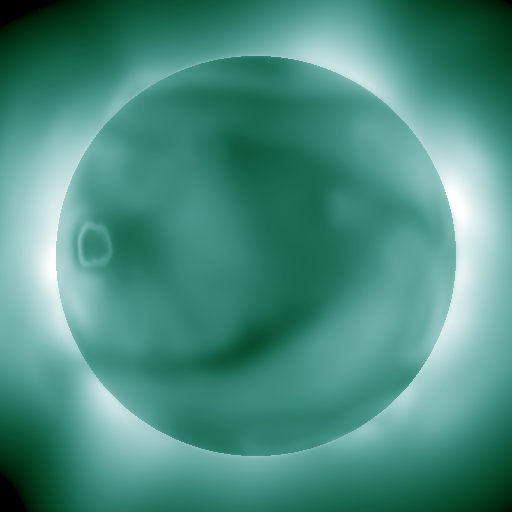
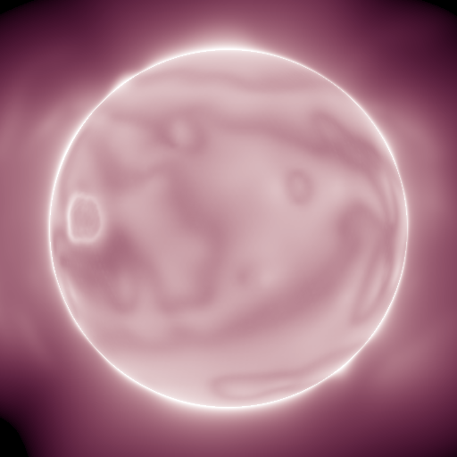
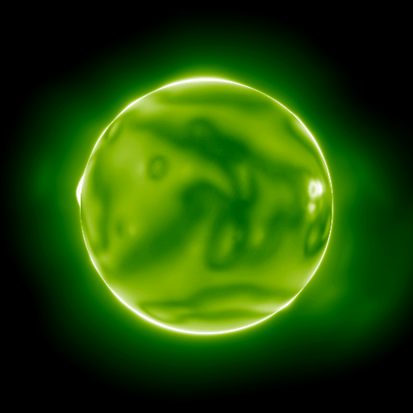
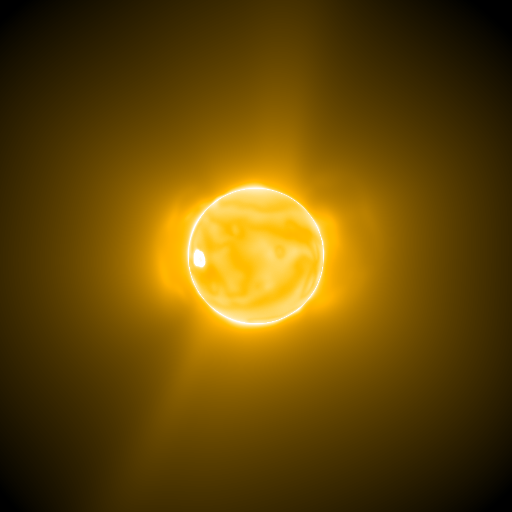

# EUV imaging

Synthetic extreme-ultraviolet (EUV) images of the solution, in the channels and units of SDO/AIA,
STEREO/EUVI and Solar Orbiter/EUI. This product uses the electron density and the temperature. It
does not build a Q⊥ volume.

| AIA 94 | AIA 131 | AIA 171 | AIA 193 |
|:------:|:-------:|:-------:|:-------:|
|  |  |  |  |

| AIA 211 | AIA 335 | EUVI-A 195 (STEREO-A) | EUI FSI 174 (Solar Orbiter) |
|:-------:|:-------:|:---------------------:|:---------------------------:|
|  |  |  |  |

The gallery shows the example solution of the
[quick start](../getting-started/first-eclipse-image.md) in eight channels. Each image has its own
display range, so the gallery compares shapes, not brightness.

??? note "The commands of the gallery"
    The images are 512 × 512 pixels, without the colour bar and the stamp. Each instrument views
    from its own spacecraft at the solution time.

    ```bash
    qorona euv data/coconut_corona.CFmesh.xz -o data/euv.png \
        --timestamp 2025-10-09T18:19:52 --frame carrington --range auto \
        --width 512 --height 512 --no-colorbar --no-annotate \
        --channel aia-94,aia-131,aia-171,aia-193,aia-211,aia-335
    qorona euv data/coconut_corona.CFmesh.xz -o data/euv_euvi-a-195.png \
        --timestamp 2025-10-09T18:19:52 --frame carrington --range auto \
        --width 512 --height 512 --no-colorbar --no-annotate --channel euvi-a-195
    qorona euv data/coconut_corona.CFmesh.xz -o data/euv_eui-fsi-174.png \
        --timestamp 2025-10-09T18:19:52 --frame carrington --range auto \
        --width 512 --height 512 --no-colorbar --no-annotate --channel eui-fsi-174
    ```

The commands below make the same AIA images at the default size, 1024 × 1024 pixels, with the
colour bar and the stamp.

For one image, give one channel. The command writes `data/euv.png`:

```bash
qorona euv data/coconut_corona.CFmesh.xz -o data/euv.png \
    --timestamp 2025-10-09T18:19:52 --frame carrington --range auto \
    --channel aia-193
```

For one image for each channel, give a comma list of channels of one instrument. The command
writes one file for each channel, for example `data/euv_aia-193.png`:

```bash
qorona euv data/coconut_corona.CFmesh.xz -o data/euv.png \
    --timestamp 2025-10-09T18:19:52 --frame carrington --range auto \
    --channel aia-94,aia-131,aia-171,aia-193,aia-211,aia-335
```

The input is a coronal solution file with a density, and a temperature or a pressure. A `.qor`
volume does not keep the temperature, so `euv` does not accept it.

This example solution is hotter and less dense than the real corona, so its values are far below
the observed AIA values. With the default display range, its image is black, and `euv` tells you
to try `--range auto`. `--range auto` fits the display range to each image.

## Flags

| Flag | Use | Default |
|------|-----|---------|
| `--channel` | The channel: `aia-94`, `aia-131`, `aia-171`, `aia-193`, `aia-211`, `aia-335`, `euvi-a-171`, `euvi-a-195`, `euvi-a-284` (the same for `euvi-b`) or `eui-fsi-174`. A comma list of channels of one instrument writes one image for each channel. | `aia-193` |
| `--tr-temperature` | The broadening temperature of the run, in K, or `none`. See [Transition region](#transition-region). | from the run log, if there is one |
| `--abundances` | The element abundances of the response tables: `coronal-2021` or `schmelz-2012`. | `coronal-2021` |
| `--range LO,HI` | The display range of the log image, in the channel unit. `auto` uses the 0.5 and 99.9 percentiles of the image. | a fixed range for each channel |
| `--no-colorbar` | Removes the colour bar beside the image. | colour bar |
| `--no-absorption` | Removes the foreground absorption. | absorption |
| `--step` | The line-of-sight sample spacing, in solar radii. | 0.001 |
| `--export npz` | Also writes the physical frame and the image axes, in degrees. See [Exported values](#exported-values). | none |
| `--export fits` | Also writes the physical frame as FITS, with the WCS of the camera. Needs `--timestamp`. See [Export to JHelioviewer](../jhelioviewer.md#fits-images). | none |

- Camera flags: see [Camera and viewpoint](../camera.md). `euv` uses the perspective camera only.
  The default field of view is the field of the instrument, at 1024 × 1024 pixels.
  `--instrument aia`, `euvi-a`, `euvi-b` or `eui-fsi` gives the native frame of the instrument.
- If you give `--timestamp` and no `--observer`, `--longitude`, `--latitude` or
  `--observer-distance`, the observer is the spacecraft of the channel: `earth` for AIA,
  `stereo-a` or `stereo-b` for EUVI, `solo` for EUI. See
  [Use a real observer](../camera.md#use-a-real-observer) and
  [Solution time and frame](../time-and-frame.md).
- `qorona euv --help-all` lists all the flags, with the grid flags (`--outer-radius`, `--n-r` and
  others). See [Method](#method).

## Method

- Each pixel integrates `nₑ² K(T, nₑ)` along the line of sight, through the corona. `K` is the
  response of the channel to the lines and the continuum of the plasma. See
  [Response tables](#response-tables).
- The density and the temperature are resampled onto an internal spherical grid from 1 to 3 solar
  radii, with 384 × 180 × 360 nodes (radius, colatitude, longitude) and a logarithmic radial
  spacing. If the field of the camera reaches further, the grid extends to it, with the same
  radial spacing at the base.
- The emission is optically thin. The solar body is opaque: a line of sight that meets the body
  stops at the inner radius of the grid.
- The foreground absorption by the photoionization of H I, He I and He II dims the emission behind
  cool, dense plasma. The cross-section is that of the nominal wavelength of the channel. The
  cross-sections follow the `ismeuv` routine of the IDL Astronomy User's Library.
- The electron density is `ρ / (μ m_p)`, with the `μ` of the model. See
  [Brightness units](white-light.md#brightness-units).
- The plasma has one temperature. If the solution stores the temperature, `euv` uses it. If not,
  the temperature is `p / (2 nₑ k)`.

## Units

The values are for one native pixel of the instrument, at any image size. `--width` changes the
sharpness, not the values.

| Instrument | Unit | Native pixel |
|------------|------|--------------|
| AIA | DN s⁻¹ per pixel | 0.6″ |
| EUI/FSI | DN s⁻¹ per pixel | 4.44″ |
| EUVI | detected photons s⁻¹ per pixel, as in EUVI Level 1 images | 1.588″ (EUVI-A), 1.590″ (EUVI-B) |

## Exported values

The PNG is a display image: the logarithm of the frame on the display range, in the colour map of
the channel. For values, use `--export npz` or `--export fits`. With a list of channels, each
channel has its own files, named as the PNG.

| Export | Content |
|--------|---------|
| `npz` | `frame`: the image in the channel unit, float32. `x_deg`, `y_deg`: the image axes, in degrees from Sun centre, with row 0 at the top of the image. `impact`: the distance of each line of sight from Sun centre, in solar radii. `unit`: the unit of `frame`. `meta`: the run settings, as JSON. |
| `fits` | One float32 image in the channel unit. See [FITS images](../jhelioviewer.md#fits-images) for the coordinates. `BUNIT` is the unit, `WAVELNTH` the wavelength of the channel, `NATPIXEL` the native pixel in arcseconds, `TRTEMP` the Tc of the [transition-region](#transition-region) correction, and `DISPMIN` and `DISPMAX` the display range of the PNG. The `HIERARCH QORONA` cards hold the run settings. |

The run settings include the internal grid, `μ`, the source of the temperature, the abundances, the
CHIANTI version and the response file of each channel.

## Compare with observations

1. Give `--timestamp` and `--frame`, so that the camera is at the position of the spacecraft at
   the solution time.
2. Add `--export fits`. The file holds the coordinates and the observer of the image. See
   [FITS images](../jhelioviewer.md#fits-images).
3. Convert the observed image to the unit of the channel for each second. If the observed image
   is in counts for each exposure, divide it by its exposure time.
4. For AIA, correct the observed image for the degradation of the instrument, for example with
   `aiapy`. The response tables are those of the instrument without degradation.
5. Use the same pixel grid for the two images. At the default size, one image pixel is wider than
   one native pixel, but its value is that of one native pixel. Each image pixel is one line of
   sight through the pixel centre, not an average across the pixel. For an exact comparison, use
   `--instrument` to render the native frame. For an approximate comparison, average the observed
   pixels onto the grid of the synthetic image. Do not sum them.

The synthetic image has no point-spread function and no noise.

## Response tables

Each channel has one response table for each set of abundances. The tables come with Qorona. Each
table gives `K` at fixed temperatures and electron densities.

| Item | Value |
|------|-------|
| Atomic data | CHIANTI 11.0.2, with the CHIANTI ionization equilibrium file `chianti.ioneq` |
| Calculation | [fiasco](https://fiasco.readthedocs.io/) 0.9.0 |
| Emission | The spectral lines, and the free-free, free-bound and two-photon continua |
| `coronal-2021` | The CHIANTI abundance file `sun_coronal_2021_chianti` |
| `schmelz-2012` | The CHIANTI abundance file `sun_coronal_2012_schmelz` |
| AIA response | `aia_V8_all_fullinst.genx`, read with `aiapy`, without degradation, with the crosstalk between channels |
| EUVI response | `ahead_sra_001.geny` (EUVI-A) and `behind_sra_001.geny` (EUVI-B), with the open position of the filter wheel |
| EUI/FSI response | `FSI_Response_Merged_R0_AlZr25_V2.txt` |
| Temperatures | 10⁴ to 10⁸ K, at steps of 0.02 in log₁₀ T (201 values) |
| Electron densities | 10⁶ to 10¹³ cm⁻³, at steps of 0.1 in log₁₀ nₑ (71 values) |

- Between these values, `euv` interpolates `log K` linearly in `log T` and `log nₑ`.
- Below 10⁴ K, the plasma gives no emission in these channels.
- Above 10⁸ K, and outside the density limits, `K` keeps the value at the limit.
- The tables use ionization equilibrium. They do not include time-dependent ionization.

## Transition region

Some runs include the transition region: their inner boundary is in the chromosphere, below
10⁵ K. The solver broadens this thin layer artificially below a temperature Tc, which is a setting
of the run. The broadened layer is far too bright in EUV. `euv` divides the emission by
`f(T) = [1 + (T / Tc)⁻¹⁰]^(1/4)` (Iijima & Imada 2021). Above approximately 2 Tc, `f` is 1.

`euv` finds the transition region with a test on the base layer of the solution: the cells within
1.005 times the smallest cell radius. If the median temperature of this layer is below 10⁵ K, the
solution includes the transition region.

| Solution | Tc |
|----------|----|
| MAS, with the `omas` run log next to its files | Read from the log (`T_CUTOFF1`). |
| Other runs with a transition region | Give it with `--tr-temperature`, for example `--tr-temperature 2e5`. |
| Runs without a transition region | Not needed. |

- If the solution includes the transition region and Tc is not known, `euv` stops. Give
  `--tr-temperature`, or `--tr-temperature none` to render without the correction.
- `--tr-temperature` overrides the value of the run log.
- The run summary and the FITS header (`TRTEMP`) show Tc.

## References

- Dere, K. P., et al. 1997, *Astronomy and Astrophysics Supplement Series*, 125, 149. The CHIANTI
  atomic database. [doi:10.1051/aas:1997368](https://doi.org/10.1051/aas:1997368)
- Dere, K. P., et al. 2023, *The Astrophysical Journal Supplement Series*, 268, 52. CHIANTI 10.1:
  the ionization equilibrium file `chianti.ioneq` and the abundance file
  `sun_coronal_2021_chianti`.
  [doi:10.3847/1538-4365/acec79](https://doi.org/10.3847/1538-4365/acec79)
- Dufresne, R. P., et al. 2024, *The Astrophysical Journal*, 974, 71. CHIANTI 11, the version of
  the response tables. [doi:10.3847/1538-4357/ad6765](https://doi.org/10.3847/1538-4357/ad6765)
- Schmelz, J. T., et al. 2012, *The Astrophysical Journal*, 755, 33. The coronal abundances of
  `schmelz-2012`. [doi:10.1088/0004-637X/755/1/33](https://doi.org/10.1088/0004-637X/755/1/33)
- Iijima, H., & Imada, S. 2021, *The Astrophysical Journal*, 917, 65. The correction of the
  broadened transition region.
  [doi:10.3847/1538-4357/ac07a5](https://doi.org/10.3847/1538-4357/ac07a5)
- Lemen, J. R., et al. 2012, *Solar Physics*, 275, 17. The AIA instrument.
  [doi:10.1007/s11207-011-9776-8](https://doi.org/10.1007/s11207-011-9776-8)
- Boerner, P., et al. 2012, *Solar Physics*, 275, 41. The calibration and the temperature
  response of AIA. [doi:10.1007/s11207-011-9804-8](https://doi.org/10.1007/s11207-011-9804-8)
- Barnes, W. T., et al. 2020, *Journal of Open Source Software*, 5, 2801. aiapy, which reads the
  AIA response. [doi:10.21105/joss.02801](https://doi.org/10.21105/joss.02801)
- Howard, R. A., et al. 2008, *Space Science Reviews*, 136, 67. The SECCHI instruments of
  STEREO, with EUVI. [doi:10.1007/s11214-008-9341-4](https://doi.org/10.1007/s11214-008-9341-4)
- Rochus, P., et al. 2020, *Astronomy & Astrophysics*, 642, A8. The EUI instrument of Solar
  Orbiter. [doi:10.1051/0004-6361/201936663](https://doi.org/10.1051/0004-6361/201936663)
