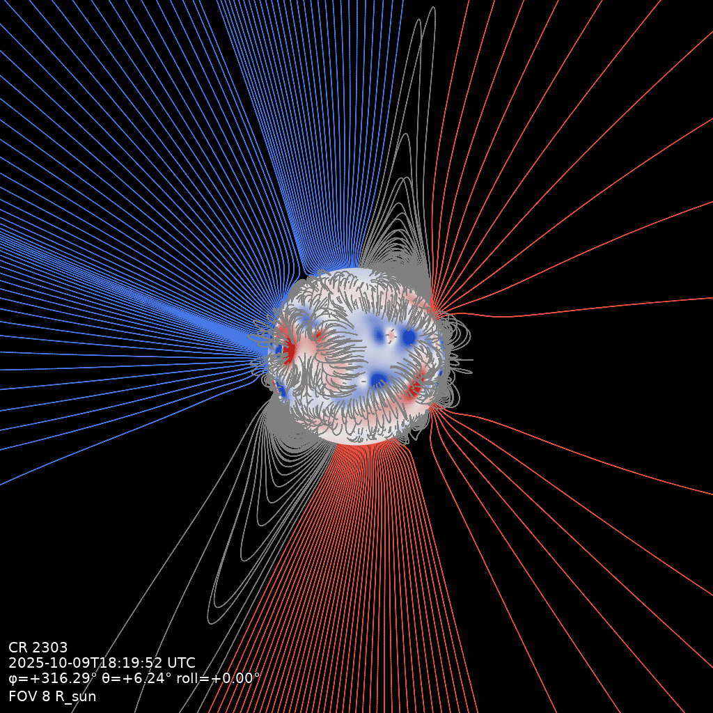

# Field lines

A view of traced field lines over the solar disk. The default view looks like an eclipse
photograph:

- the open fan at the limb and short closed loops on the front;
- lines coloured by the polarity of their inner foot;
- a B_r magnetogram on the disk.

`fieldlines` traces the solution file directly. It does not use a `.qor` volume.



```bash
qorona fieldlines data/coconut_corona.CFmesh.xz -o data/fieldlines.png \
    --timestamp 2025-10-09T18:19:52 --fov 8 --longitude 317 --latitude 6.2 --seeds 1650
```

## Flags

| Flag | Use | Default |
|------|-----|---------|
| `--seeding` | `limb` (front loops and the open fan at the limb) or `uniform` (a uniform sphere). | `limb` |
| `--seeds` | The number of seeds: front loops (`limb`) or the full sphere (`uniform`). | 1500 |
| `--limb-seeds` | The number of seeds around the limb, for the open fan. | 375 |
| `--colour` | `polarity` (the sign of B_r at the inner foot) or `rainbow` (one hue for each line). | `polarity` |
| `--magnetogram`, `--no-magnetogram` | Show or hide the B_r disk. | shown |
| `--show` | `all`, `open` or `closed` lines. | `all` |
| `--depth-fade` | Dim the far-side lines by up to this fraction. | 0.4 |
| `--export sunjson` | Also write the drawn lines as SunJSON. See [Export to JHelioviewer](../jhelioviewer.md#field-lines-as-sunjson). | none |

Camera flags: see [Camera and viewpoint](../camera.md).
