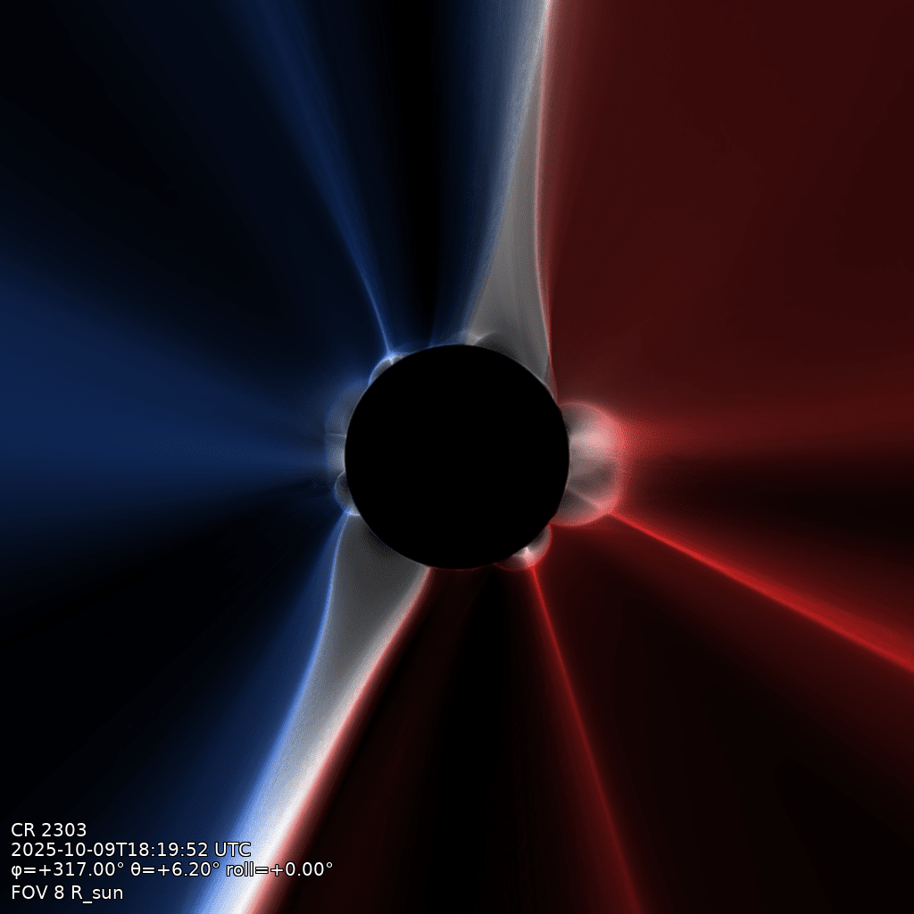

# Polarity view

The squashing-factor render, coloured by magnetic polarity.



```bash
qorona render data/coconut_corona.qor -o data/polarity.png \
    --fov 8 --longitude 317 --latitude 6.2 --polarity-mode hue
```

| Colour | Field along the line of sight |
|--------|-------------------------------|
| Warm | Outward. |
| Cool | Inward. |
| White | Opposite polarities that cancel, for example at the current sheet between two open-field regions. |

## Flags

| Flag | Command | Use | Default |
|------|---------|-----|---------|
| `--polarity-mode` | `render` | `hue` colours the render by polarity. `none` gives the plain render. | `none` |
| `--closed` | `build` | The polarity of closed loops: `neutral` (white) or `dominant` (the sign of the stronger foot). | `neutral` |

- The volume stores the polarity, so choose `--closed` when you build. An open field line takes the
  sign of B·r̂ at its foot on the photosphere. A closed loop has two feet of opposite sign.
- Camera flags: see [Camera and viewpoint](../camera.md). The other render flags are the same as
  for the [squashing-factor render](squashing-factor.md#flags).
