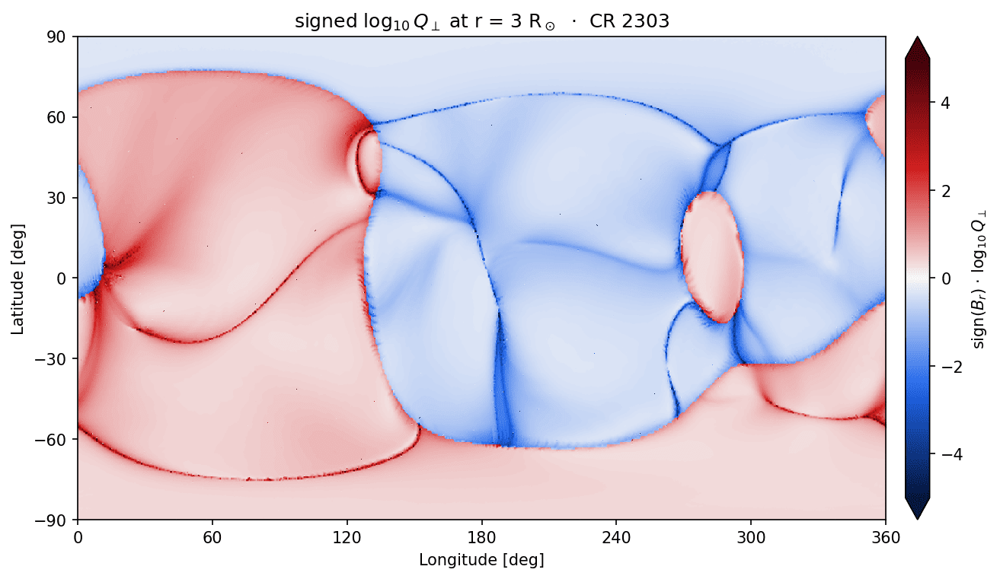

# Q-maps

A synoptic map of signed log₁₀ Q⊥ on a sphere at a fixed radius. `qmap` slices a built volume. It
does not read or trace the solution again.



Build the volume with `--outer-radius` equal to the map radius, then slice it:

```bash
qorona build data/coconut_corona.CFmesh.xz -o data/coconut_corona_or3.qor \
    --timestamp 2025-10-09T18:19:52 --frame carrington --outer-radius 3
qorona qmap data/coconut_corona_or3.qor -o data/qmap.png --radius 3
```

The map shows sign(B·r̂) · log₁₀ Q⊥, so the colour gives the polarity of the radial field.

- The line between the two colours is the base of the heliospheric current sheet.
- The bright ridges are the arcs of the S-web.
- The longitudes are in the [frame of the solution](../time-and-frame.md).

## Flags

| Flag | Use | Default |
|------|-----|---------|
| `--radius` | The radius of the sphere, in solar radii. | 3 |
| `--resolution NTHETAxNPHI` | The display grid. Qorona interpolates; the grid of the build limits the detail. | `720x1440` |
| `--slog-max` | The colour limit of the signed log. | 5 |
| `--export npz` | Also write the raw arrays of the sphere. | none |
