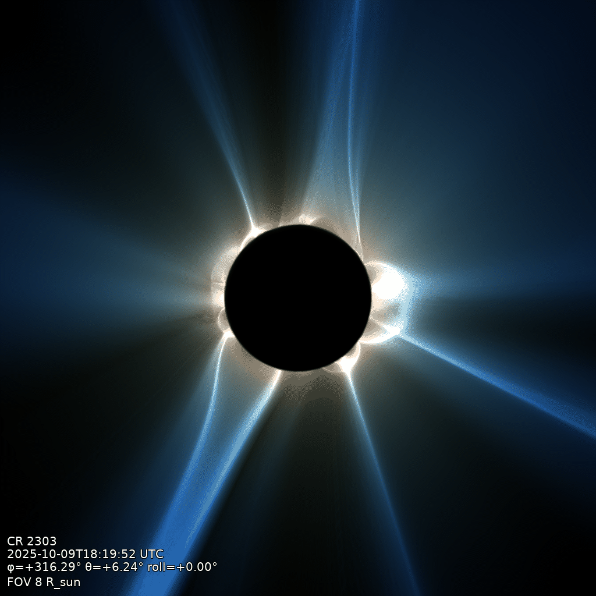
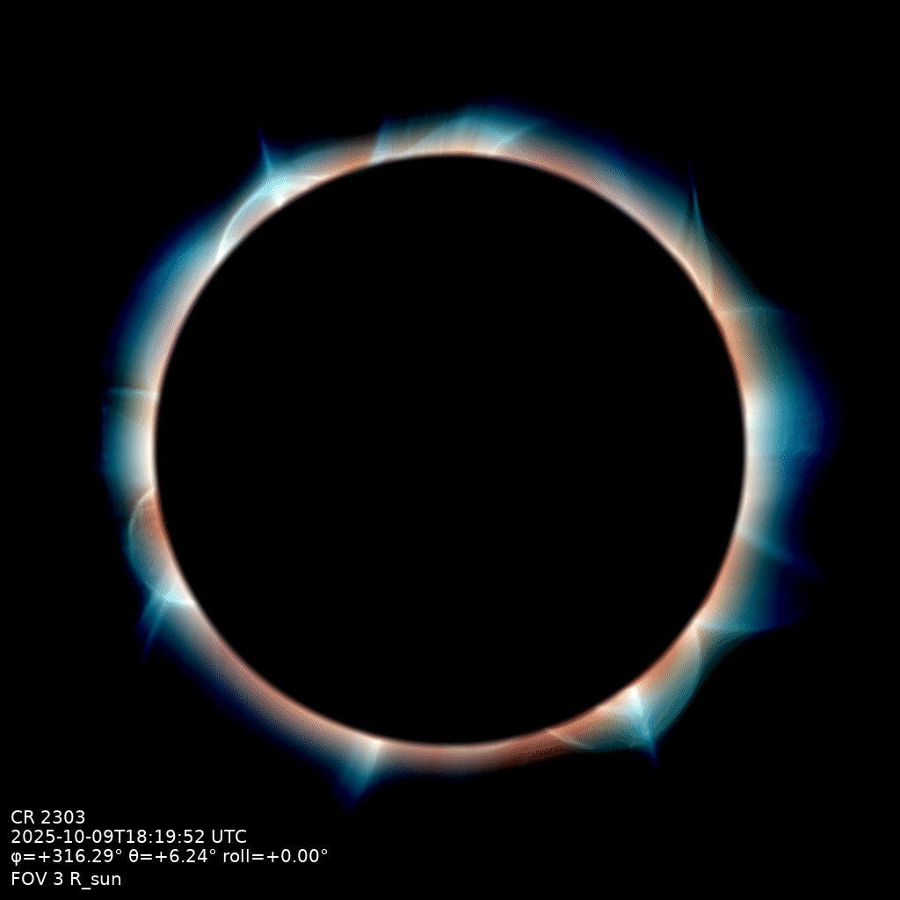
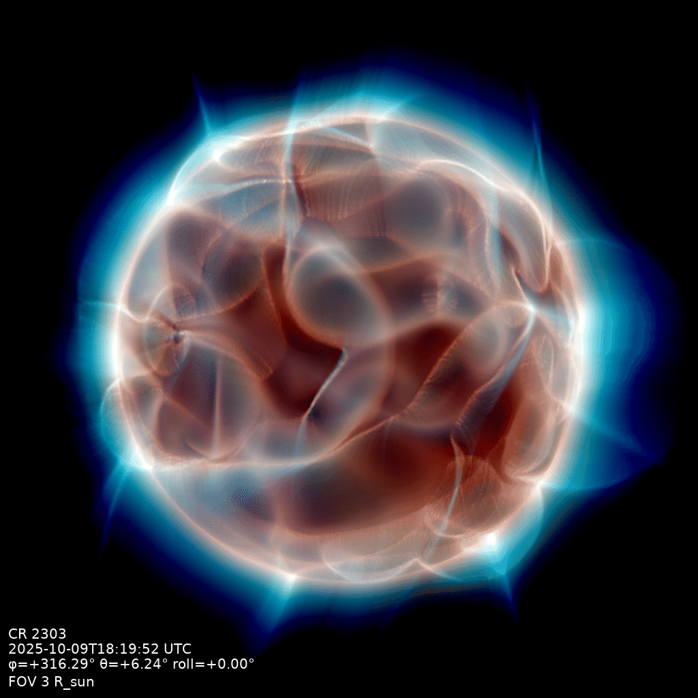

# Squashing-factor render

The main product: the line-of-sight integral of log₁₀ Q⊥ through the
[Q⊥ volume](../qperp-volume.md). Q⊥ is the perpendicular squashing factor. It is large in the
quasi-separatrix layers, where neighbouring field lines separate quickly, so the render shows the
fine structure seen at a total solar eclipse.



```bash
qorona render data/coconut_corona.qor -o data/eclipse.png --fov 8 --observer earth
```

## Flags

| Flag | Use | Default |
|------|-----|---------|
| `--occult` | The treatment of the solar body. See [Occultation modes](#occultation-modes). | `eclipse` |
| `--preset` | The depth weighting: `large-fov`, or `small-fov` for the [near-limb view](#near-limb-view). | `large-fov` |
| `--step` | The line-of-sight sample spacing, in solar radii. | 0.02 |
| `--export fits` | Also write the line-of-sight average of log₁₀ Q⊥ as FITS. See [Export to JHelioviewer](../jhelioviewer.md). | none |

- Camera flags (`--fov`, `--longitude`, `--observer` and more): see
  [Camera and viewpoint](../camera.md).
- `qorona render --help-all` lists all the flags.

## Near-limb view

For the low corona, use a small field of view with the small-field depth weighting:
`--fov 3 --preset small-fov`. This example also uses `--occult opaque`, so the disk shows the Q⊥
structure at the surface.


```bash
qorona render data/coconut_corona.qor -o data/near-limb.png \
    --fov 3 --observer earth --preset small-fov --step 0.002 --occult opaque
```

!!! warning "Use a fine step for a small field of view"
    The default `--step 0.02` suits whole-corona views. At a small field of view, thin sheets alias
    at this step. Use `--step 0.002`.

## Occultation modes

| `--occult` | The solar body |
|------------|----------------|
| `eclipse` (default) | A dark disk. |
| `opaque` | A solid body. The disk shows the Q⊥ structure at the surface, as in the near-limb view. |
| `none` | No body. The integral goes through the whole volume. |
| `composite` | The eclipse image, with the disk filled by a toned-down near-limb view. Use it for whole-corona views. `--disk-tone` and `--disk-desat` adjust the disk. |

At whole-corona scale the disk is small, and `eclipse` and `none` look almost the same. This
comparison uses the near-limb settings:

| `eclipse` (default) | `none` |
|---------------------|--------|
|  |  |

```bash
qorona render data/coconut_corona.qor -o data/occult-<mode>.png \
    --fov 3 --observer earth --preset small-fov --step 0.002 --occult <mode>
```

The `composite` mode on a whole-corona view:


```bash
qorona render data/coconut_corona.qor -o data/composite.png \
    --fov 8 --observer earth --occult composite
```

## References

- Mikić, Z., et al. 2018, *Nature Astronomy*, 2, 913. The line-of-sight rendering of the
  squashing factor for eclipse comparison, and the large- and small-field-of-view depth
  weightings used by `--preset`.
  [doi:10.1038/s41550-018-0562-5](https://doi.org/10.1038/s41550-018-0562-5)
- Titov, V. S. 2007, *The Astrophysical Journal*, 660, 863. The perpendicular squashing
  factor Q⊥. [doi:10.1086/512671](https://doi.org/10.1086/512671)
- Dhib, R., et al. 2026, *The Astrophysical Journal*. The Qorona method and its validation.
  [doi:10.3847/1538-4357/aea841](https://doi.org/10.3847/1538-4357/aea841)
