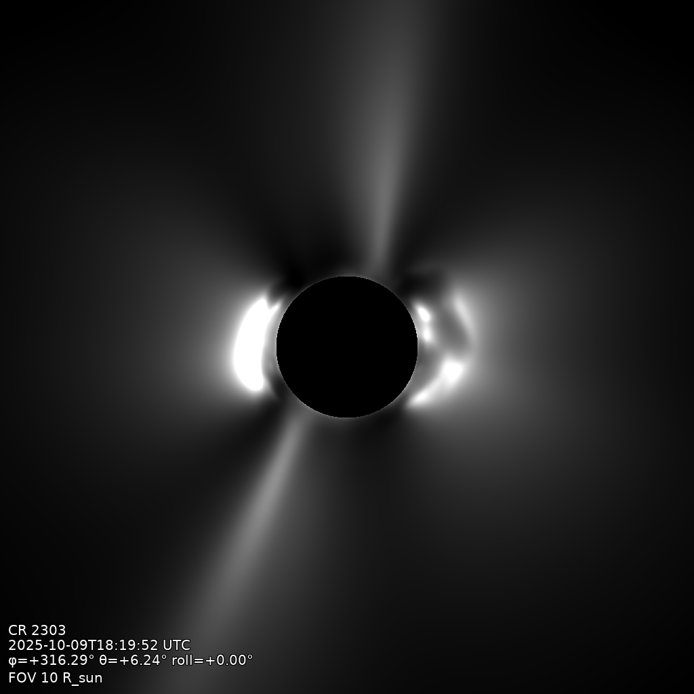

# White-light imaging

The Thomson-scattered brightness of the electrons of the solution: the white-light K corona. The
default is pB, the polarized brightness. This product uses only the electron density. It does not
build a Q⊥ volume.



```bash
qorona wl data/coconut_corona.qor -o data/white-light.png \
    --longitude 317 --latitude 6.2
```

The input is a solution file or a `.qor` volume. A volume is faster, because it keeps the resampled
density.

## Flags

| Flag | Use | Default |
|------|-----|---------|
| `--component` | `polarized` (pB) or `total` brightness. | `polarized` |
| `--vignette` | The display treatment of the brightness falloff. See [Display treatments](#display-treatments). | `adaptive` for COCONUT, else `newkirk` |
| `--percentiles LOW HIGH` | The display stretch. `0 100` keeps the full range. | `1 99.5` |
| `--mgn` | Fine-structure enhancement (multi-scale Gaussian normalization), applied last. | off |
| `--occult` | `eclipse` or `none`. | `eclipse` |
| `--r-occult` | The occulter radius, in solar radii. | 1.02 |
| `--export npz` | Also write the raw pB and total frames and their image coordinates: solar radii for the orthographic camera, degrees for the perspective camera. | none |
| `--export fits` | Also write the display frame and the raw frames as FITS. See [Export to JHelioviewer](../jhelioviewer.md#fits-images). | none |

- Camera flags: see [Camera and viewpoint](../camera.md). On a coronal solution, `wl` uses
  `--fov 10`.
- To compare with PUNCH images, see [Comparing with PUNCH](../punch.md).

## Display treatments

| `--vignette` | Treatment |
|--------------|-----------|
| `newkirk` | Divides by the brightness of the smooth Newkirk background corona. |
| `adaptive` | Fits the same curve family to the falloff of the image. |
| `wow` | Whitens the wavelet spectrum of the raw frame (Wavelets Optimized Whitening). |
| `none` | Keeps the raw falloff. |

!!! note "Extra packages for `--vignette wow` and `--mgn`"
    `--vignette wow` and `--mgn` need [sunkit-image](https://docs.sunpy.org/projects/sunkit-image/).
    `wow` also needs [watroo](https://github.com/frederic-auchere/watroo). Install both with
    `pip install sunkit-image watroo`. `watroo` is not on conda-forge.

## Brightness units

The raw frames are in mean solar brightness (MSB) for every supported model.

The electron density is `nₑ = ρ / (μ m_p)`, with `μ` the mean molecular weight of the model.
`--mean-molecular-weight` overrides the default `μ` of the model: COCONUT 1.27, MAS 1, Icarus 1.

- The MSB values are in the `npz` export and in the `PB` and `TOTAL` extensions of the FITS
  export. The PNG and the FITS primary image are display frames.
- The run summary states the unit of the frames, `MSB` (with `μ`) or `relative`.
- `--brightness-scale relative` gives relative frames on any input.
- A `.qor` volume built by an earlier version of Qorona gives relative frames. Rebuild it to get
  MSB.
